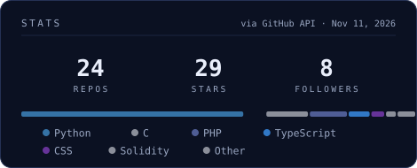
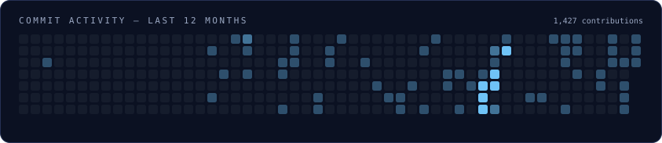

# Sohaim Muqtada

Cybersecurity student at **UMT Lahore** — working close to the implementation: application security, offensive tooling, and applied post-quantum cryptography on constrained devices.

<table>
  <tr>
    <td width="33.3%" valign="top">

### Now

- **CVE research** — php2shell RCE frontier on amd64
- **Hybrid PQC signing** on ESP32-S3
- **AI governance & security** — [Jaiza](https://jaiza-chi.vercel.app/)

    </td>
    <td width="33.3%" valign="top">

### Focus

- **Authorization** & business-logic testing
- **Security tooling** & automation
- **Applied crypto** on constrained devices

    </td>
    <td width="33.3%" valign="top">

### Signal

- **Director** — UMT CyberSecurity Society
- **Intern** — Dafi Labs × EmpRadar.ai
- **Public tooling** — recon frameworks, PQC firmware, security labs

    </td>
  </tr>
</table>

### // selected work

**[esp32-hybrid-pqc-key-exchange](https://github.com/muhammadsohaimmuqtada/esp32-hybrid-pqc-key-exchange)** — `C` · `ESP-IDF` · `PQC`  
Hybrid X25519 + ML-KEM-768 key exchange & secure telemetry for ESP32 — firmware, verification backend, benchmarks, reproducible test vectors.

**[logic-lab-security](https://github.com/muhammadsohaimmuqtada/logic-lab-security)** — `Flask` · `AppSec`  
Intentionally vulnerable multi-tenant SaaS — authorization, tenant isolation, workflow, commerce & race-condition labs.

**[dedsec](https://github.com/muhammadsohaimmuqtada/dedsec)** — `Python` · `Recon`  
13-module recon framework for authorized web testing — WAF fingerprinting, DNS, TLS, subdomains, structured reports.

**[php2shell-version-frontier](https://github.com/muhammadsohaimmuqtada/php2shell-version-frontier)** — `Python` · `CVE`  
Measured php2shell (CVE-2026-109618/109619) RCE frontier on amd64 — gdb crash forensics, per-build profiles, method.

### // telemetry

*Telemetry is generated from the live GitHub API and refreshed daily via GitHub Actions.*

---

**Technical Team Director, UMT CyberSecurity Society** · [LinkedIn](https://www.linkedin.com/in/sohaim-muqtada/) · [Jaiza](https://jaiza-chi.vercel.app/)
